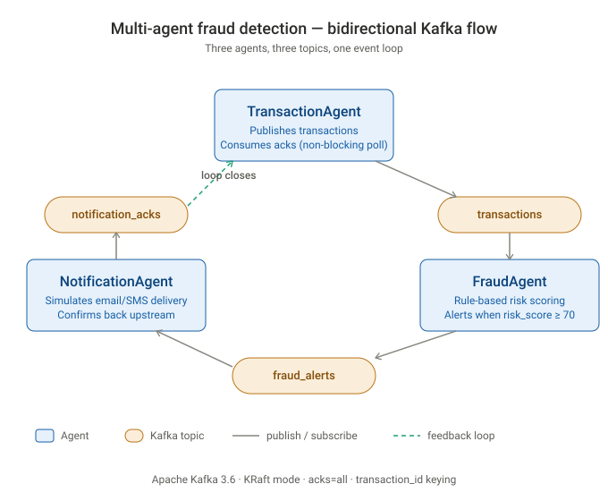

# Multi-Agent Fraud Detection on Apache Kafka

> **Decentralized architectures replace monolithic latency with event-driven agility.**
> Three autonomous agents detect and respond to fraudulent transactions through a bidirectional Kafka event loop — Kafka topics act as the **central nervous system**, enabling zero-dependency agent interaction.

[](https://www.python.org/downloads/)
[-231F20.svg)](https://kafka.apache.org/)
[](https://www.docker.com/)
[](LICENSE)

📄 **[Read the full architectural review (PDF)](docs/technical-report.pdf)** — 8-page technical deep-dive with diagrams, scoring logic, lifecycle traces, and extensibility analysis.

---

## 🎯 Why This Project

Most "multi-agent" portfolio projects are sequential pipelines: `Agent A → Agent B → Agent C`. That isn't a real multi-agent system — it's a function call wearing a fancy hat.

This project implements a **true bidirectional event loop**: the `TransactionAgent` not only *publishes* transactions, it also *consumes* acknowledgments from the `NotificationAgent` — closing the feedback loop **without blocking ingestion**. To do this, the producer uses **non-blocking consumer polling**, a pattern lifted directly from production Kafka systems.

**The core architectural insight:** Separation of *ingestion* from *analysis*. Transaction volume keeps flowing regardless of how fast downstream agents process. This mirrors how real payment processors (Stripe, Square, banks) detect fraud at scale — high-throughput, ordered-per-account, and resilient to broker failures.

---

## 🏗️ Architecture



The three agents communicate via three Kafka topics in a **closed loop** — the dashed green arrow showing `notification_acks → TransactionAgent` is what makes this a multi-agent system rather than a one-way pipeline.

| Agent | Subscribes to | Publishes to | Role |
|-------|---------------|--------------|------|
| **TransactionAgent** | `notification_acks` | `transactions` | Generates synthetic transactions; learns when downstream has handled alerts |
| **FraudAgent** | `transactions` | `fraud_alerts` | Applies rule-based risk scoring; alerts on `risk_score ≥ 70` |
| **NotificationAgent** | `fraud_alerts` | `notification_acks` | Simulates alert delivery (email/SMS/push); confirms back upstream |

---

## 🔑 Key Technical Decisions

These are the design choices that distinguish this from a tutorial project. Each is a real trade-off, not a default.

### 1. Bidirectional event loop with non-blocking poll

The `TransactionAgent` continuously publishes transactions *and* consumes acks from downstream — at the same time, in one thread, without blocking.

```python
# In transaction_agent.py
while True:
    # Non-blocking check for acknowledgements
    polled = consumer.poll(timeout_ms=100)
    for _tp, records in polled.items():
        for record in records:
            # Process ack...

    # Continue publishing transactions
    producer.send(topics.transactions, key=tx_id, value=tx)
```

**Why it matters:** A blocking `for msg in consumer:` loop would freeze publishing every time we waited for an ack. Polling with a 100ms timeout lets the agent stay responsive to both directions of the flow.

### 2. `transaction_id` as partition key — ordering + idempotency

Every producer call uses the transaction ID as the Kafka message key:

```python
producer.send(topics.transactions, key=tx_id, value=tx)
```

**Why it matters:**
- **Ordering guarantee:** Kafka guarantees order *within a partition*. Keying by `transaction_id` ensures all events about the same transaction land on the same partition and are processed in order.
- **Idempotency foundation:** Downstream consumers can safely deduplicate by `transaction_id` — critical for fraud systems where double-alerting a customer is a real cost.

### 3. `acks="all"` + `retries=3` — production durability

```python
producer = KafkaProducer(
    bootstrap_servers=bs,
    acks="all",      # Wait for all in-sync replicas to confirm
    retries=3,       # Retry transient broker failures
    ...
)
```

**Trade-off:** Higher latency (~10–50ms per send vs. ~1ms with `acks=0`), but no message loss on broker restart. For fraud detection, missed alerts are unacceptable — latency is the right thing to trade.

### 4. KRaft mode (no ZooKeeper)

Uses Kafka 3.6 in **KRaft mode** — the modern metadata management approach replacing ZooKeeper. Simpler deployment, fewer moving parts, future-proof (ZooKeeper is being deprecated in Kafka 4.0).

---

## ✅ Verification: 5-Layer Evidence Chain

A working system isn't enough — you have to prove it works. This project includes a complete evidence chain:

| Layer | Evidence | File |
|-------|----------|------|
| 1. Broker running | `docker ps` showing `kafka_broker` container `Up` | [`logs/docker_ps.txt`](logs/docker_ps.txt) · [screenshot](logs/screenshots/Evidence_04_KafkaBroker_DockerPS.png) |
| 2. Transactions flowing | `TransactionAgent` log: `Published transaction_id=tx_xxx` | [`logs/evidence_transaction_tail.txt`](logs/evidence_transaction_tail.txt) · [screenshot](logs/screenshots/Evidence_01_TransactionAgent.png) |
| 3. Fraud detection working | `FraudAgent` log: `Published fraud_alert for transaction_id=tx_xxx (risk_score=90)` | [`logs/evidence_fraud_tail.txt`](logs/evidence_fraud_tail.txt) · [screenshot](logs/screenshots/Evidence_02_FraudAgent.png) |
| 4. Notifications delivered | `NotificationAgent` log: `Published notification_ack for transaction_id=tx_xxx` | [`logs/evidence_notification_tail.txt`](logs/evidence_notification_tail.txt) · [screenshot](logs/screenshots/Evidence_03_NotificationAgent.png) |
| 5. Loop closing | `TransactionAgent` log: `Received ack for transaction_id=tx_xxx status=NOTIFIED` | (visible in transaction log) |

**Cross-reference sample:** Transaction `tx_400493` appears in all four logs at `01:28:46–01:28:46`, confirming end-to-end propagation in ~1 second.

---

## 🚀 Quick Start

### Prerequisites
- Docker + Docker Compose
- Python 3.11+

### Run it

```bash
# 1. Start the Kafka broker (KRaft mode, no ZooKeeper)
docker compose up -d

# 2. Set up Python environment
python -m venv .venv
source .venv/bin/activate          # macOS/Linux
# .venv\Scripts\activate           # Windows
pip install -r requirements.txt

# 3. Run each agent in a separate terminal
python -m src.transaction_agent    # Terminal A
python -m src.fraud_agent          # Terminal B
python -m src.notification_agent   # Terminal C
```

Within ~5 seconds you should see transactions flowing, fraud alerts triggering on `risk_score >= 70`, and ack messages closing the loop back to `TransactionAgent`.

### Optional config

```bash
export KAFKA_BOOTSTRAP=localhost:9092    # default
```

---

## 🧠 Trade-offs and Production Considerations

Being honest about what this project *doesn't* do — and where the architecture lets future versions plug in cleanly.

### The pub/sub foundation enables three properties

| Property | What it means | Why pub/sub enables it |
|----------|---------------|-----------------------|
| **Linear scalability** | Handle more volume by adding more agents | Kafka consumer groups distribute partitions automatically — no code changes needed |
| **Auditability** | Every decision traceable post-hoc | Every event (with reasoning + scoring) is persisted in the topic — replay any decision |
| **Extensibility** | Add new agents without re-engineering | New agents subscribe to existing topics — zero changes to existing code |

### Natural extension points

| Extension | What's reserved for it | Why it slots in cleanly |
|-----------|----------------------|------------------------|
| **ML Model Agent** | A second consumer on `transactions` running an ML scorer in parallel with the rule-based agent | Both agents can co-exist; downstream can compare or ensemble their `fraud_alerts` outputs |
| **Audit Logger Agent** | A third consumer on `transactions` + `fraud_alerts` writing to cold storage | Pub/sub means observers can subscribe to any topic without affecting existing flow |
| **Threshold tuning** | Change `risk_score >= 70` cutoff in `FraudAgent` | No pipeline restart needed — just redeploy that one agent |

### What this project intentionally doesn't include

| Aspect | This project | Production system would add |
|--------|-------------|-----------------------------|
| **Fraud logic** | Rule-based (amount + merchant heuristics) | ML model with feature store and online inference |
| **Delivery guarantee** | At-least-once (auto-commit offsets) | Exactly-once semantics via transactional producer + manual offset commits |
| **Scaling** | Single broker, single partition | Multi-broker cluster, partitioned topics, consumer groups |
| **Schema management** | Ad-hoc JSON | Schema Registry + Avro/Protobuf |
| **Observability** | stdout logging | Structured logs + Prometheus metrics + distributed tracing |
| **Testing** | Manual end-to-end verification | Unit tests + integration tests + chaos engineering |

The streaming architecture and agent coordination patterns shown here are the foundation; the items above are natural extensions.

---

## 📁 Repo Structure

```
agentic-ai-pubsub-kafka/
├── src/
│   ├── __init__.py
│   ├── common.py              # Shared utilities (topics, event schema, logging)
│   ├── transaction_agent.py   # Publisher + ack consumer
│   ├── fraud_agent.py         # Rule-based risk scorer
│   └── notification_agent.py  # Alert delivery simulator
├── docs/
│   ├── architecture.svg       # System diagram
│   └── technical-report.pdf   # 8-page architectural review
├── logs/                      # 5-layer evidence chain
│   ├── docker_ps.txt
│   ├── evidence_transaction_tail.txt
│   ├── evidence_fraud_tail.txt
│   ├── evidence_notification_tail.txt
│   └── screenshots/           # Visual proof (terminal captures)
├── docker-compose.yml         # Kafka 3.6 in KRaft mode
├── requirements.txt
├── .gitignore
├── LICENSE
└── README.md
```

---

## 📚 What I Learned

- **Distributed systems thinking:** Designing for failure (retries, idempotency keys) is fundamentally different from designing for correctness alone.
- **Kafka internals:** Partition keying is the lever for ordering guarantees; offset management is the lever for delivery semantics.
- **Agentic architecture:** "Multi-agent" requires bidirectional communication. Unidirectional pipelines are workflows, not agent systems.

---

## 📄 License

MIT — see [LICENSE](LICENSE).

---

*Built as part of CSYE 7380 (Northeastern University, Spring 2026) by [Renna Wu](https://linkedin.com/in/renna-wu).*
